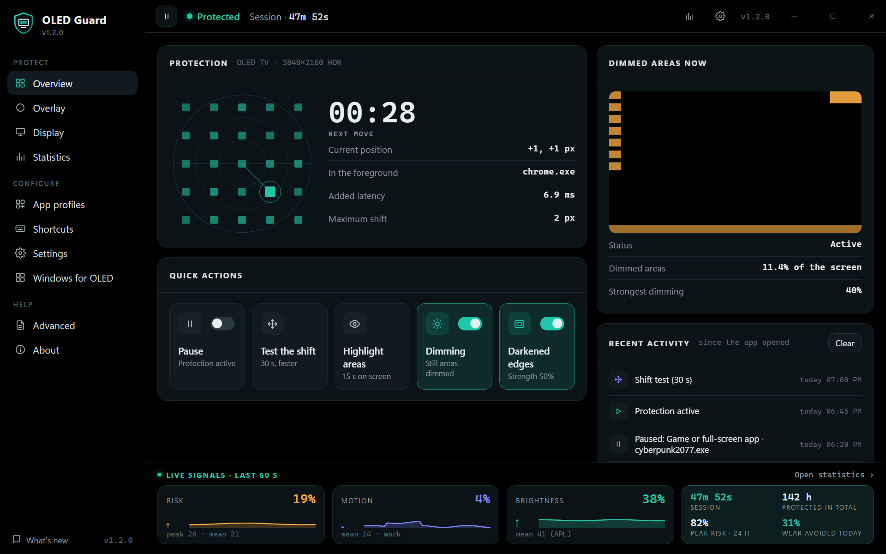
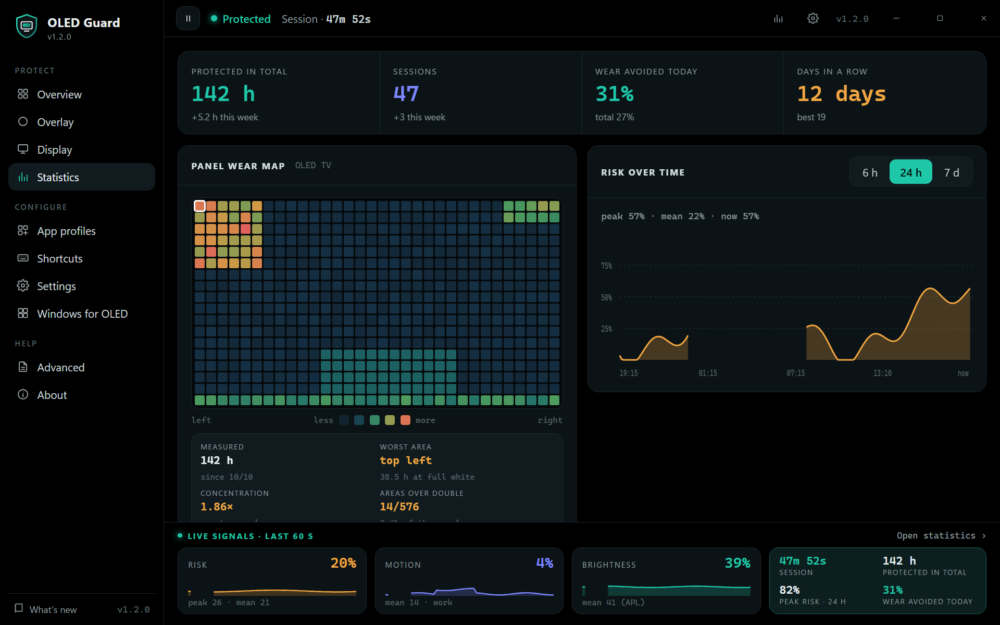
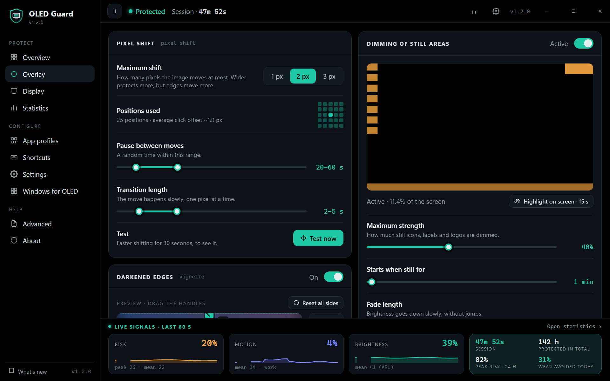

# OLED Guard

[](https://github.com/fedefreak92/oled-guard/actions/workflows/ci.yml)
[](LICENSE)

[English](README.md) · [Italiano](README.it.md) · [Español](README.es.md) · **Deutsch** · [Français](README.fr.md)

> Maschinelle Übersetzung, die noch von Muttersprachlern geprüft werden muss.
> Korrekturen sind willkommen. Maßgeblich ist die [englische Fassung](README.md).

Eine Windows-App, die einen OLED-Monitor oder -Fernseher am PC vor Einbrennen
(Burn-in) schützt. Viele OLED-Fernseher haben keinen Schutz für die Nutzung am PC, wo
Taskleiste, Symbole und Fensterrahmen stundenlang auf denselben Pixeln stehen.
OLED Guard nimmt den Desktop auf der GPU auf und zeichnet ihn, um 1-3 Pixel verschoben,
in einem klickdurchlässigen Overlay neu. Außerdem dunkelt es kleine Elemente ab, die
lange unbewegt und hell bleiben (Taskleiste, Symbole, Logos), und zeigt Live-Signale
und Nutzungsstatistiken.



| Statistik | Overlay-Einstellungen |
| --- | --- |
|  |  |

*Bildschirmfotos der Oberfläche im Vorschaumodus, mit Beispieldaten (auf Englisch).*

## Funktionen

- **Pixelverschiebung**: Der ganze Desktop verschiebt sich alle 20-60 s um 1-3 px,
  verteilt über 2-5 s, damit Text nie verschwimmt oder springt. Funktioniert in HDR
  und SDR mit originalgetreuen Farben.
- **Abdunkeln unbewegter Bereiche**: Ein Compute-Shader findet 16x16-px-Zellen, die
  seit Minuten hell und unverändert sind, und dunkelt nur die kleinen (Taskleiste,
  Symbole, Logos) langsam ab; Dokumente, die du liest, bleiben unberührt. Das Fenster
  unter der Maus wird sofort wieder normal.
- **Software-Helligkeit, abgedunkelte Ränder und Abwesenheitsmodus**, der das Bild
  absenkt, wenn du dich vom PC entfernst.
- **Automatische Pause** bei Spielen, Vollbild-Apps, Präsentationen, gesperrtem
  Bildschirm, UAC, Sitzungswechsel und **geschützten Fenstern** (siehe unten), dazu
  Regeln pro App.
- **Live-Signale und Statistik**: Risiko, Bewegung und Helligkeit der letzten 60 s,
  eine Verschleißkarte des Panels, die seinen Proportionen folgt (16:9, 16:10,
  Ultrawide, Super-Ultrawide), ein Risikodiagramm über 6 h / 24 h / 7 T, die
  meistgenutzten Apps und eine Warnung in der Taskleiste, wenn das ungeschützte Risiko
  hoch bleibt. Die Statistik verlässt nie den PC.
- **Ersteinrichtung**: Sprache und zu schützenden Bildschirm wählen; **Identifizieren**
  zeigt auf jedem Bildschirm eine große Zahl, praktisch mit Fernseher und Monitor
  nebeneinander. Der Schutz startet erst nach deiner Bestätigung.
- **Fünf Sprachen**: Englisch, Italienisch, Spanisch, Deutsch und Französisch, nach
  der Windows-Sprache oder in den Einstellungen gewählt.
- **Windows-Einstellungen für OLED** (nur auf Wunsch, mit Sicherung und
  Wiederherstellung): dunkler Modus, automatisch ausgeblendete Taskleiste,
  Bildschirmabschaltung, schwarzer Bildschirmschoner und Hintergrund, ausgeblendete
  Desktopsymbole und mehr.
- **Diagnose exportieren**: eine lesbare Textdatei für Fehlerberichte.
- Symbol im Infobereich, globale Tastenkombinationen, Autostart, einzelne Instanz,
  Protokolle und ein Notausstieg.

## Download und erster Start

1. Lade die neueste `oled-guard-<Version>-windows-x64.zip` unter
   [Releases](https://github.com/fedefreak92/oled-guard/releases) herunter und prüfe
   sie bei Bedarf mit der `.sha256`-Datei daneben.
2. Entpacke sie an einen beliebigen Ort und starte `oled-guard.exe`. Sonst muss nichts
   installiert werden: Die C++-Laufzeit ist enthalten, und die WebView2-Runtime für
   das Fenster ist in Windows 11 schon vorhanden (unter Windows 10 sagt dir die App, wo
   du sie bekommst; der Schutz funktioniert auch ohne sie über den Infobereich).
3. Das Release ist nicht signiert, daher zeigt Windows SmartScreen beim ersten Start
   eine Warnung: *Weitere Informationen → Trotzdem ausführen*.
4. Folge den drei Schritten: Sprache, OLED-Bildschirm, kurze Zusammenfassung.

## Geschützte Fenster und Videos

Manche Apps verbergen ihre Fenster vor Bildschirmaufnahmen: geschützte Videos (etwa in
Streaming-Apps), Passwortmanager wie KeePassXC, manche Banking-Apps. Da das Overlay ein
aufgenommenes Bild neu zeichnet, würde es sie mit Schwarz oder dem Desktop dahinter
verdecken. OLED Guard pausiert automatisch, solange ein solches Fenster auf dem
geschützten Bildschirm sichtbar ist (abschaltbar unter *App-Profile*).

Geschützte Videos **in einem Browser** kann Windows nicht erkennen. Im Vollbild
pausiert der Schutz trotzdem von selbst; im Fenster nutze die manuelle Pause oder lege
unter *App-Profile* eine Regel für den Browser an.

## So funktioniert es

Die Aufnahme (Desktop Duplication) bleibt auf der GPU; Compute-Shader entscheiden,
welche Zellen unbewegt und hell sind und wie stark sie abgedunkelt werden; ein
Pixel-Shader zeichnet das verschobene Bild in ein DirectComposition-Overlay, das Klicks
durchlässt und von Aufnahmen ausgeschlossen ist. Die CPU liest keine Desktop-Pixel:
Nur eine kleine Zusammenfassung kommt asynchron zurück. Der echte Mauszeiger wird nicht
angetastet. Ein Notfall-Thread mit eigener Tastenkombination und ein Watchdog entfernen
das Overlay, wenn etwas nicht mehr reagiert. Technische Details im
[englischen README](README.md#how-it-works).

## Bauen und testen

```powershell
powershell -ExecutionPolicy Bypass -File build.ps1
```

baut und führt die Unit-Tests und die Shader-Tests aus (auf WARP, ohne Grafikkarte).
Benötigt wird Visual Studio 2022 oder neuer mit der C++-Desktop-Workload. Mehr dazu im
[englischen README](README.md#building).

## Nutzung

OLED Guard läuft im Infobereich und schützt den bei der Ersteinrichtung gewählten
Bildschirm (änderbar im Menü des Infobereichs oder auf der Seite *Bildschirm*).
Standard-Tastenkombinationen (anpassbar):

| Tasten | Aktion |
| --- | --- |
| `Ctrl+Alt+Shift+P` | Pausieren / fortsetzen |
| `Ctrl+Alt+Shift+O` | Bildschirm ausschalten |
| `Ctrl+Alt+Shift+F12` | Notausstieg |

Einstellungen, Statistik, Verlauf, Sicherung der Windows-Einstellungen und Protokolle
liegen in `%APPDATA%\oled-guard`, die exportierte Diagnose in *Dokumente*.
Administratorrechte sind nicht nötig. Windows-Einstellungen ändern sich nur, wenn du sie
auf der Seite *Windows für OLED* übernimmst, und *Wie vorher wiederherstellen* setzt die
gespeicherten Werte zurück.

## Unterstützte Systeme

- **Windows 11**: getestet.
- **Windows 10 Version 2004 oder neuer**: unterstützt, weniger getestet. Ältere
  Versionen zeigen eine Meldung und starten nicht.
- Monitore und Fernseher, SDR und HDR, jede Bildwiederholrate und Auflösung. Gründlich
  getestet auf einem System (RTX 5080, LG-OLED-Fernseher, HDR an): Berichte von anderen
  Bildschirmen und GPUs sind sehr willkommen.

## Ein Problem melden

Öffne ein Issue mit dem Formular *Bug report*: Es fragt nach Bildschirm, GPU,
Windows-Version und der Diagnosedatei (*Erweitert → Diagnose exportieren* oder das Menü
des Infobereichs). Lies die Datei vor dem Anhängen: Die Konfiguration enthält die Namen
der Apps in deinen Regeln. Es wird nie etwas automatisch gesendet.

## Einschränkungen

- Ein Bildschirm zur Zeit. Gedrehte Bildschirme (Hochformat) werden nicht unterstützt.
- Geschützte Videos in einem Browser werden nicht erkannt.
- Laptops: noch kein besonderes Verhalten für den Akku.
- Das Release ist nicht signiert.

## Haftungsausschluss

OLED Guard verkürzt die Zeit, in der dieselben Pixel leuchten, kann aber nicht
garantieren, dass ein Panel nicht einbrennt. Nutze weiterhin die eingebaute Panelpflege
deines Bildschirms (Pixel Refresh und, falls vorhanden, seine eigene
Pixelverschiebung). Die App kommuniziert nicht mit dem Bildschirm und ändert seine
Firmware nicht.

## Lizenz

[MIT](LICENSE). Komponenten von Drittanbietern sind in
[THIRD_PARTY_NOTICES.md](THIRD_PARTY_NOTICES.md) aufgeführt.
