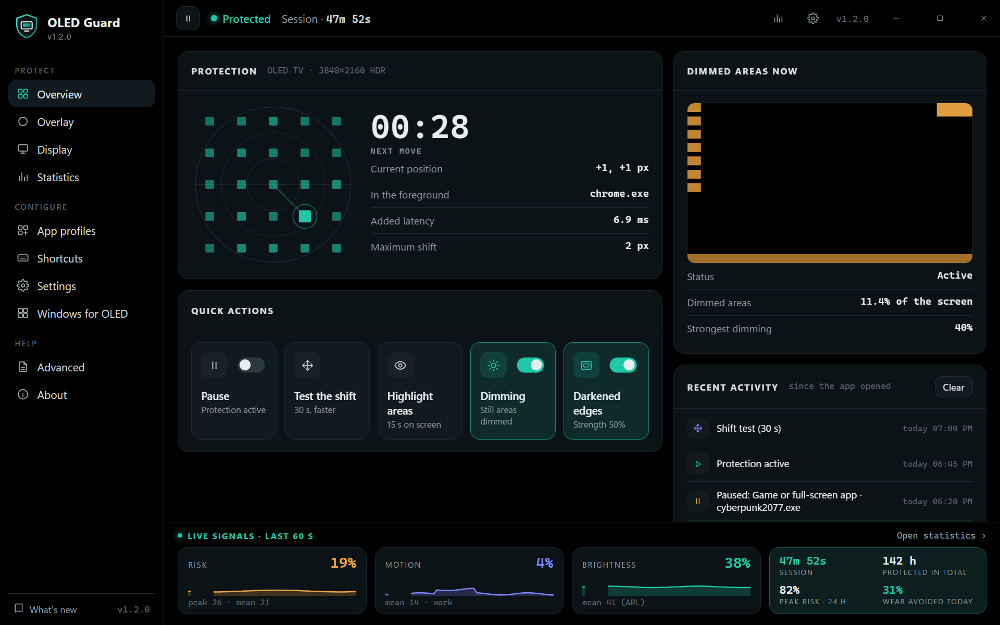
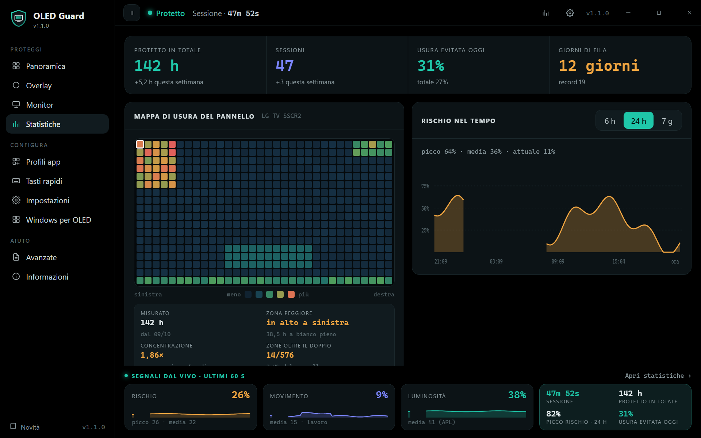
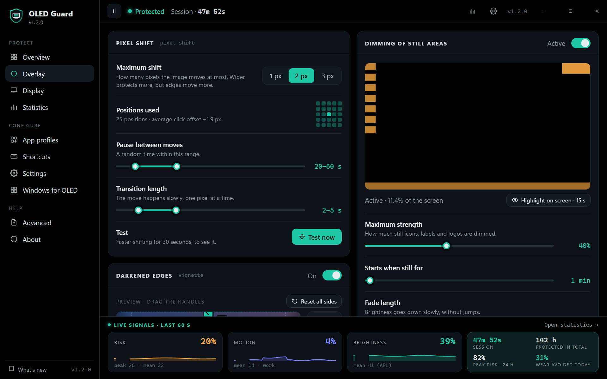

# OLED Guard

[](https://github.com/fedefreak92/oled-guard/actions/workflows/ci.yml)
[](LICENSE)

[English](README.md) · [Italiano](README.it.md) · **Español** · [Deutsch](README.de.md) · [Français](README.fr.md)

> Traducción automática pendiente de revisión por un hablante nativo. Las correcciones
> son bienvenidas. La versión de referencia es la [inglesa](README.md).

Una app para Windows que protege del quemado (burn-in) un monitor o un televisor OLED
usado con el PC. Muchos televisores OLED no tienen una protección pensada para el uso
con PC, donde la barra de tareas, los iconos y los bordes de las ventanas pasan horas
sobre los mismos píxeles. OLED Guard captura el escritorio en la GPU y lo vuelve a
dibujar, desplazado 1-3 píxeles, en un overlay que deja pasar los clics. Además atenúa
los elementos pequeños quietos y brillantes durante mucho tiempo (barra, iconos,
logotipos) y muestra señales en directo y estadísticas de uso.



| Estadísticas | Ajustes del overlay |
| --- | --- |
|  |  |

*Capturas de la interfaz en modo de vista previa, con datos de demostración (en inglés).*

## Funciones

- **Desplazamiento de píxeles**: todo el escritorio se mueve 1-3 px cada 20-60 s,
  repartido en 2-5 s para que el texto nunca se vea borroso ni salte. Funciona en HDR
  y SDR con colores fieles.
- **Atenuación de zonas quietas**: un compute shader encuentra las celdas de 16x16 px
  brillantes y sin cambios durante minutos y atenúa poco a poco solo las pequeñas
  (barra, iconos, logotipos), sin tocar los documentos que estás leyendo. La ventana
  bajo el ratón vuelve a la normalidad al instante.
- **Brillo por software, bordes oscurecidos y modo ausente**, que baja la imagen cuando
  te alejas del PC.
- **Pausa automática** en juegos, apps a pantalla completa, presentaciones, pantalla
  bloqueada, UAC, cambio de sesión y con **ventanas protegidas** (ver más abajo), además
  de reglas por app.
- **Señales en directo y estadísticas**: riesgo, movimiento y brillo de los últimos
  60 s, un mapa de desgaste del panel que sigue sus proporciones (16:9, 16:10,
  ultrapanorámico, superultrapanorámico), un gráfico de riesgo de 6 h / 24 h / 7 d, las
  apps más usadas y un aviso en la barra de tareas cuando el riesgo sin proteger sigue
  alto. Las estadísticas nunca salen del PC.
- **Configuración inicial**: elige el idioma y la pantalla que se protege; **Identificar**
  muestra un número grande en cada pantalla, útil con un televisor y un monitor juntos.
  La protección empieza solo cuando confirmas.
- **Cinco idiomas**: inglés, italiano, español, alemán y francés, según el idioma de
  Windows o elegido en Ajustes.
- **Ajustes de Windows para OLED** (solo si los pides, con copia y restauración): modo
  oscuro, barra de tareas que se oculta, apagado de la pantalla, protector de pantalla
  y fondo negros, iconos del escritorio ocultos y más.
- **Exportar diagnóstico**: un archivo de texto legible para adjuntar a los informes.
- Icono en la bandeja, atajos globales, inicio automático, una sola instancia,
  registros y una salida de emergencia.

## Descarga y primer inicio

1. Descarga el último `oled-guard-<versión>-windows-x64.zip` desde
   [Releases](https://github.com/fedefreak92/oled-guard/releases) y, si quieres,
   compruébalo con el archivo `.sha256` que lo acompaña.
2. Descomprímelo donde quieras y ejecuta `oled-guard.exe`. No hace falta instalar nada
   más: el runtime de C++ va incluido y el runtime WebView2 de la ventana ya viene con
   Windows 11 (en Windows 10 la app te indica dónde conseguirlo, y la protección
   funciona desde la bandeja sin él).
3. La versión no está firmada, así que Windows SmartScreen muestra un aviso la primera
   vez: elige *Más información → Ejecutar de todas formas*.
4. Sigue los tres pasos: idioma, pantalla OLED y un breve resumen.

## Ventanas y vídeo protegidos

Algunas apps ocultan sus ventanas de la captura de pantalla: vídeo protegido (por
ejemplo en apps de streaming), gestores de contraseñas como KeePassXC, algunas apps
bancarias. Como el overlay vuelve a dibujar una imagen capturada, las taparía con negro
o con el escritorio de detrás. OLED Guard se pausa automáticamente mientras una ventana
así está visible en la pantalla protegida (se puede desactivar en *Perfiles de apps*).

Windows no puede detectar el vídeo protegido **dentro de un navegador**. A pantalla
completa la protección se pausa sola de todos modos; en ventana, usa la pausa manual o
añade una regla para el navegador en *Perfiles de apps*.

## Cómo funciona

La captura (Desktop Duplication) se queda en la GPU; los compute shaders deciden qué
celdas están quietas y brillantes y cuánto atenuarlas; un pixel shader dibuja la imagen
desplazada en un overlay de DirectComposition, transparente a los clics y excluido de
la captura. La CPU no lee ningún píxel del escritorio: solo vuelve un pequeño resumen,
de forma asíncrona. El cursor real no se toca. Un hilo de emergencia con su propio
atajo y un watchdog quitan el overlay si algo deja de responder. Los detalles técnicos
están en el [README en inglés](README.md#how-it-works).

## Compilar y probar

```powershell
powershell -ExecutionPolicy Bypass -File build.ps1
```

compila y ejecuta las pruebas unitarias y las de los shaders (en WARP, sin tarjeta
gráfica). Hace falta Visual Studio 2022 o posterior con el entorno C++ de escritorio.
Más detalles en el [README en inglés](README.md#building).

## Uso

OLED Guard se queda en la bandeja y protege la pantalla elegida en el primer inicio
(se cambia desde el menú de la bandeja o la página *Pantalla*). Atajos predeterminados
(configurables):

| Atajo | Acción |
| --- | --- |
| `Ctrl+Alt+Shift+P` | Pausar / reanudar |
| `Ctrl+Alt+Shift+F12` | Salida de emergencia |

Ajustes, estadísticas, historial, copia de los ajustes de Windows y registros están en
`%APPDATA%\oled-guard`; el diagnóstico exportado, en *Documentos*. No hacen falta
permisos de administrador. Los ajustes de Windows solo cambian cuando los aplicas
desde la página *Windows para OLED*, y *Restaurar como antes* vuelve a poner los
valores guardados.

## Sistemas compatibles

- **Windows 11**: probado.
- **Windows 10 versión 2004 o posterior**: compatible, menos probado. Las versiones
  anteriores muestran un mensaje y no se inician.
- Monitores y televisores, SDR y HDR, cualquier frecuencia y resolución. Probado a fondo
  en una configuración (RTX 5080, televisor LG OLED, HDR activado): los informes desde
  otras pantallas y GPU son muy bienvenidos.

## Informar de un problema

Abre una incidencia con el formulario *Bug report*: pide la pantalla, la GPU, la
versión de Windows y el archivo de diagnóstico (*Avanzado → Exportar diagnóstico*, o el
menú de la bandeja). Lee el archivo antes de adjuntarlo: la configuración contiene los
nombres de las apps de tus reglas. Nunca se envía nada automáticamente.

## Limitaciones

- Una pantalla a la vez. Las pantallas giradas (vertical) no son compatibles.
- No se detecta el vídeo protegido dentro de un navegador.
- Portátiles: todavía sin comportamiento específico para la batería.
- La versión no está firmada.

## Aviso

OLED Guard reduce el tiempo que los mismos píxeles permanecen encendidos, pero no puede
garantizar que el panel no sufra quemado. Sigue usando el cuidado del panel de tu
pantalla (pixel refresh y, si lo tiene, su propio desplazamiento de píxeles). No se
comunica con la pantalla ni modifica su firmware.

## Licencia

Copyright (C) 2026 fedefreak92. OLED Guard es software libre con licencia
[GNU General Public License v3.0](LICENSE) (GPL-3.0-only): puedes usarlo, estudiarlo,
modificarlo y compartirlo, y quien lo distribuya, modificado o no, debe hacerlo con la
misma licencia y junto con el código fuente. Los componentes de terceros se enumeran en
[THIRD_PARTY_NOTICES.md](THIRD_PARTY_NOTICES.md).
