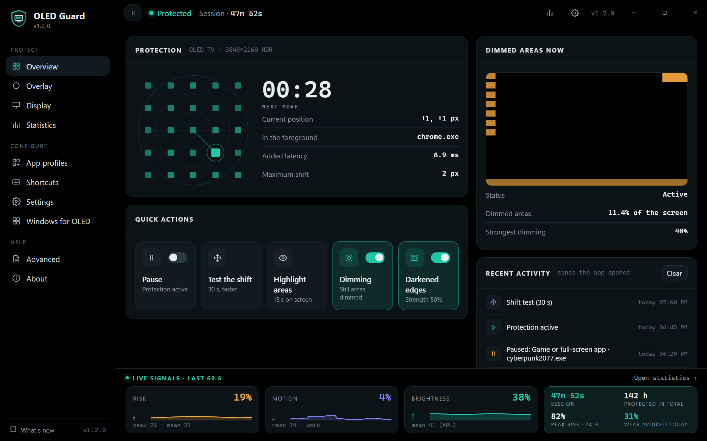
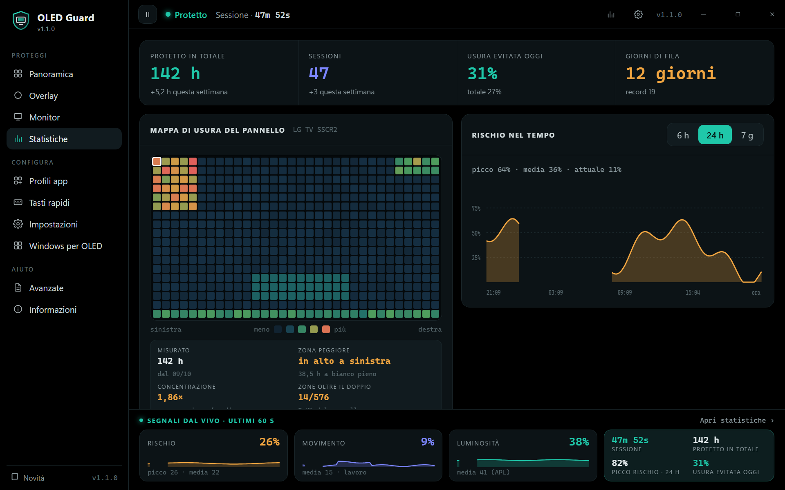
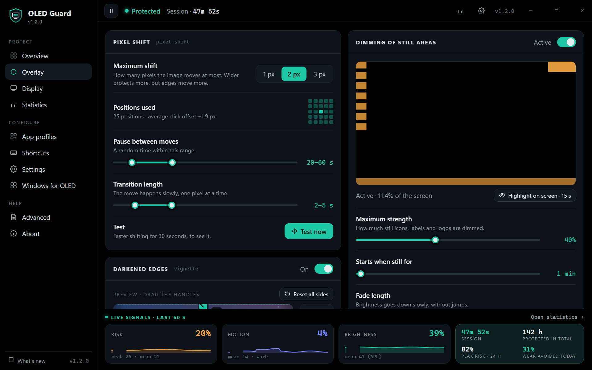

# OLED Guard

[](https://github.com/fedefreak92/oled-guard/actions/workflows/ci.yml)
[](LICENSE)

[English](README.md) · [Italiano](README.it.md) · [Español](README.es.md) · [Deutsch](README.de.md) · **Français**

> Traduction automatique en attente de relecture par un locuteur natif. Les corrections
> sont les bienvenues. La version de référence est la [version anglaise](README.md).

Une app Windows qui protège du marquage (burn-in) un moniteur ou un téléviseur OLED
utilisé avec un PC. Beaucoup de téléviseurs OLED n'ont pas de protection pensée pour un
usage PC, où la barre des tâches, les icônes et les bords des fenêtres restent des heures
sur les mêmes pixels. OLED Guard capture le bureau sur le GPU et le redessine, décalé de
1 à 3 pixels, dans un overlay qui laisse passer les clics. Il assombrit aussi les petits
éléments immobiles et lumineux depuis longtemps (barre des tâches, icônes, logos) et
affiche des signaux en direct et des statistiques d'utilisation.



| Statistiques | Réglages de l'overlay |
| --- | --- |
|  |  |

*Captures de l'interface en mode aperçu, avec des données de démonstration (en anglais).*

## Fonctions

- **Décalage des pixels** : tout le bureau se déplace de 1 à 3 px toutes les 20 à 60 s,
  réparti sur 2 à 5 s pour que le texte ne soit jamais flou ni ne saute. Fonctionne en
  HDR et en SDR avec des couleurs fidèles.
- **Assombrissement des zones immobiles** : un compute shader repère les cellules de
  16x16 px lumineuses et inchangées depuis des minutes et n'assombrit lentement que les
  petites (barre des tâches, icônes, logos), sans toucher aux documents que tu lis. La
  fenêtre sous la souris redevient normale aussitôt.
- **Luminosité logicielle, bords assombris et mode absence**, qui baisse l'image quand
  tu t'éloignes du PC.
- **Pause automatique** pour les jeux, les apps en plein écran, les présentations,
  l'écran verrouillé, l'UAC, le changement de session et les **fenêtres protégées**
  (voir plus bas), plus des règles par app.
- **Signaux en direct et statistiques** : risque, mouvement et luminosité des 60
  dernières secondes, une carte d'usure de la dalle qui suit ses proportions (16:9,
  16:10, ultra-large, super ultra-large), un graphique du risque sur 6 h / 24 h / 7 j,
  les apps les plus utilisées et une alerte dans la barre des tâches quand le risque non
  protégé reste élevé. Les statistiques ne quittent jamais le PC.
- **Première configuration guidée** : choisis la langue et l'écran à protéger ;
  **Identifier** affiche un grand numéro sur chaque écran, pratique avec un téléviseur
  et un moniteur côte à côte. La protection démarre seulement quand tu confirmes.
- **Cinq langues** : anglais, italien, espagnol, allemand et français, selon la langue
  de Windows ou choisie dans les Paramètres.
- **Paramètres Windows pour OLED** (seulement sur demande, avec sauvegarde et
  restauration) : mode sombre, barre des tâches masquée automatiquement, extinction de
  l'écran, écran de veille et fond noirs, icônes du bureau masquées, et plus.
- **Exporter le diagnostic** : un fichier texte lisible à joindre aux rapports de bug.
- Icône dans la zone de notification, raccourcis globaux, démarrage automatique,
  instance unique, journaux et sortie d'urgence.

## Téléchargement et premier démarrage

1. Télécharge le dernier `oled-guard-<version>-windows-x64.zip` depuis les
   [Releases](https://github.com/fedefreak92/oled-guard/releases) et vérifie-le si tu
   veux avec le fichier `.sha256` à côté.
2. Décompresse-le où tu veux et lance `oled-guard.exe`. Rien d'autre à installer : le
   runtime C++ est inclus, et le runtime WebView2 de la fenêtre est déjà présent dans
   Windows 11 (sous Windows 10 l'app t'indique où le trouver, et la protection fonctionne
   sans lui depuis la zone de notification).
3. La version n'est pas signée, donc Windows SmartScreen affiche un avertissement au
   premier lancement : choisis *Informations complémentaires → Exécuter quand même*.
4. Suis les trois étapes : langue, écran OLED, court résumé.

## Fenêtres et vidéos protégées

Certaines apps cachent leurs fenêtres à la capture d'écran : vidéo protégée (par
exemple dans les apps de streaming), gestionnaires de mots de passe comme KeePassXC,
certaines apps bancaires. Comme l'overlay redessine une image capturée, il les
recouvrirait de noir ou du bureau derrière. OLED Guard se met en pause automatiquement
tant qu'une telle fenêtre est visible sur l'écran protégé (désactivable dans *Profils
d'apps*).

Windows ne peut pas détecter la vidéo protégée **dans un navigateur**. En plein écran,
la protection se met de toute façon en pause toute seule ; en fenêtre, utilise la pause
manuelle ou ajoute une règle pour le navigateur dans *Profils d'apps*.

## Fonctionnement

La capture (Desktop Duplication) reste sur le GPU ; des compute shaders décident quelles
cellules sont immobiles et lumineuses et de combien les assombrir ; un pixel shader
dessine l'image décalée dans un overlay DirectComposition, transparent aux clics et
exclu de la capture. Le CPU ne lit aucun pixel du bureau : seul un petit résumé revient,
de façon asynchrone. Le vrai curseur n'est pas touché. Un thread d'urgence avec son
propre raccourci et un watchdog retirent l'overlay si quelque chose ne répond plus. Les
détails techniques sont dans le [README anglais](README.md#how-it-works).

## Compiler et tester

```powershell
powershell -ExecutionPolicy Bypass -File build.ps1
```

compile et lance les tests unitaires et ceux des shaders (sur WARP, sans carte
graphique). Il faut Visual Studio 2022 ou ultérieur avec la charge de travail C++ pour
le bureau. Plus de détails dans le [README anglais](README.md#building).

## Utilisation

OLED Guard reste dans la zone de notification et protège l'écran choisi au premier
démarrage (modifiable depuis le menu de la zone de notification ou la page *Écran*).
Raccourcis par défaut (modifiables) :

| Raccourci | Action |
| --- | --- |
| `Ctrl+Alt+Shift+P` | Pause / reprise |
| `Ctrl+Alt+Shift+F12` | Sortie d'urgence |

Les paramètres, statistiques, historique, la sauvegarde des paramètres Windows et les
journaux sont dans `%APPDATA%\oled-guard` ; le diagnostic exporté, dans *Documents*.
Aucun droit administrateur n'est nécessaire. Les paramètres Windows ne changent que
lorsque tu les appliques depuis la page *Windows pour OLED*, et *Restaurer comme avant*
remet les valeurs enregistrées.

## Systèmes pris en charge

- **Windows 11** : testé.
- **Windows 10 version 2004 ou ultérieure** : pris en charge, moins testé. Les versions
  plus anciennes affichent un message et ne démarrent pas.
- Moniteurs et téléviseurs, SDR et HDR, toute fréquence et résolution. Testé en
  profondeur sur une configuration (RTX 5080, téléviseur LG OLED, HDR activé) : les
  retours sur d'autres écrans et GPU sont les bienvenus.

## Signaler un problème

Ouvre une issue avec le formulaire *Bug report* : il demande l'écran, le GPU, la
version de Windows et le fichier de diagnostic (*Avancé → Exporter le diagnostic*, ou
le menu de la zone de notification). Lis le fichier avant de le joindre : la
configuration contient les noms des apps de tes règles. Rien n'est jamais envoyé
automatiquement.

## Limites

- Un écran à la fois. Les écrans pivotés (portrait) ne sont pas pris en charge.
- La vidéo protégée dans un navigateur n'est pas détectée.
- Ordinateurs portables : pas encore de comportement spécifique pour la batterie.
- La version n'est pas signée.

## Avertissement

OLED Guard réduit le temps pendant lequel les mêmes pixels restent allumés, mais ne
peut pas garantir qu'une dalle ne marquera pas. Continue à utiliser l'entretien intégré
de ton écran (pixel refresh et, s'il existe, son propre décalage des pixels). L'app ne
communique pas avec l'écran et ne modifie pas son firmware.

## Licence

[MIT](LICENSE). Les composants tiers sont listés dans
[THIRD_PARTY_NOTICES.md](THIRD_PARTY_NOTICES.md).
