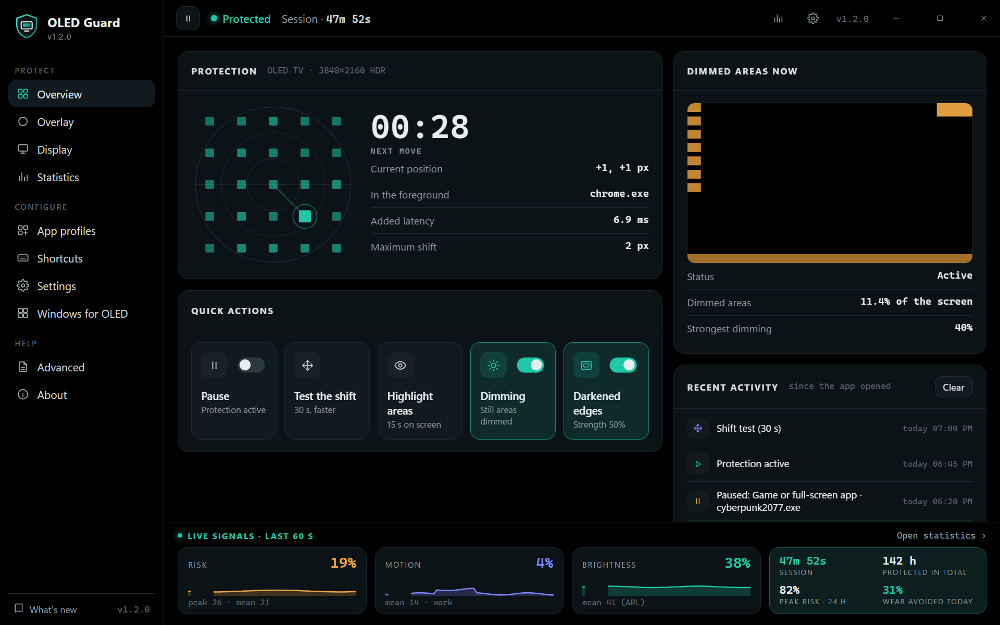

# OLED Guard

[](https://github.com/fedefreak92/oled-guard/actions/workflows/ci.yml)
[](LICENSE)

*[Read in English](README.md)*

Un'app per Windows che protegge dal burn-in una TV OLED usata come monitor del PC.
Cattura il desktop sulla GPU e lo ridisegna, spostato di 1-3 pixel, in un overlay
trasparente ai clic. Inoltre scurisce gli elementi piccoli fermi e luminosi da molto
tempo (barra delle applicazioni, icone, loghi) e mostra segnali dal vivo e
statistiche d'uso.

E' nata per una TV LG OLED 4K a 143 Hz con l'HDR sempre attivo, dove lo spostamento
integrato della TV non era un'opzione.

<!-- Screenshot: aggiungere qui le pagine Panoramica e Statistiche, per esempio
 -->

## Funzioni

- **Spostamento dell'immagine**: tutto il desktop si sposta di 1-3 px ogni 20-60 s,
  in modo graduale su 2-5 s, cosi' il testo non si sfoca e non salta. Funziona in
  HDR e in SDR con i colori fedeli.
- **Oscuramento delle aree ferme**: un compute shader trova le celle di 16x16 px
  luminose e invariate da minuti e abbassa piano piano solo quelle piccole (barra,
  icone, loghi), lasciando stare i documenti che stai leggendo. La finestra sotto il
  mouse torna subito normale.
- **Luminosita' software, bordi scuriti e modalita' assente**, che abbassa
  l'immagine quando ti allontani dal PC.
- **Pausa automatica** in giochi, app a schermo intero, presentazioni, schermo
  bloccato, UAC e cambio di sessione, piu' regole per singola app.
- **Segnali dal vivo e statistiche**: rischio, movimento e luminosita' degli ultimi
  60 s, mappa di usura del pannello 32x18, grafico del rischio 6 h / 24 h / 7 g, app
  piu' usate e un avviso nella barra delle applicazioni quando il rischio non
  protetto resta alto. Le statistiche non lasciano mai il PC.
- **Impostazioni di Windows adatte all'OLED** (solo su richiesta, con copia e
  ripristino): tema scuro, barra che si nasconde, spegnimento dello schermo,
  salvaschermo e sfondo neri, icone del desktop nascoste e altre.
- Icona nella tray, tasti rapidi globali, avvio automatico, istanza singola, log e
  uscita di emergenza.

## Come funziona

```
Desktop Duplication (DXGI)  ──►  texture D3D11 (resta sulla GPU)
                                      │
                 ┌────────────────────┼─────────────────────┐
                 ▼                    ▼                     ▼
        CSDetect / CSActivate     CSSummary            shift_ps.hlsl
        celle ferme e luminose,   32x18 zone,          disegna l'immagine spostata,
        livelli di oscuramento    letto 1 volta al s   oscuramento, luminosita', bordi
                                  (asincrono, piccolo)       │
                                                             ▼
                              overlay DirectComposition, trasparente ai clic,
                              escluso dalle catture dello schermo
```

- **La CPU non legge nessun pixel del desktop.** Torna indietro solo un piccolo buffer
  di riassunto, in modo asincrono con `D3D11_MAP_FLAG_DO_NOT_WAIT`, cosi' il thread di
  render non aspetta mai la GPU.
- **Il cursore vero non viene toccato**: lo sfasamento del clic e' pari allo
  spostamento del momento (circa 2 px). E' una scelta voluta, contro un cursore
  software che aggiungerebbe ritardo e potrebbe sparire dopo un crash.
- **Overlay a prova di guasto**: un thread di emergenza con un tasto rapido tutto suo
  e un watchdog tolgono l'overlay se il thread dell'interfaccia o quello di render
  smettono di rispondere, cosi' lo schermo non resta mai congelato o nero.
- **Interfaccia**: WebView2 con HTML/CSS/JS semplici, CSP rigida
  (`default-src 'self'`), nessuna libreria e nessun accesso alla rete.

## Struttura del codice

| Cartella | Contenuto |
| --- | --- |
| `src/core` | Logica pura senza header di Windows: pianificazione dello spostamento, regole di pausa, modello dell'oscuramento, statistiche, avviso, JSON, config, protocollo dell'interfaccia |
| `src/app` | Win32, DXGI e D3D11: cattura, thread di render, overlay, tray, tasti rapidi, file, finestra WebView2 |
| `src/app/shaders` | Shader HLSL, compilati in build con `fxc` e inclusi come header |
| `src/ui` | L'interfaccia (`mock.js` fornisce dati finti quando la pagina gira in un browser normale) |
| `tests` | Test unitari di `src/core`, con un piccolo framework senza dipendenze |
| `tests_gpu` | Test degli shader sul dispositivo software WARP |
| `docs/superpowers` | Spec di design e piani di implementazione di ogni milestone |

## Test

```powershell
powershell -ExecutionPolicy Bypass -File build.ps1
```

configura, compila ed esegue le due serie di test con CTest.

- **Test unitari**: coprono la logica pura di `src/core`.
- **Test GPU**: eseguono gli shader veri su **WARP**, il rasterizzatore software di
  Direct3D, quindi non serve una scheda video e girano anche nella CI. Ogni shader
  viene confrontato con un modello di riferimento in C++ (`src/core/dim_model.*`,
  `summary_model.*`, `shade_model.*`) su scene sintetiche: valori HDR molto sopra il
  bianco SDR, risoluzioni dispari, finestre attive e pause.

## Compilazione

Requisiti:

- Windows 11 (Windows 10 2004 o successivo potrebbe funzionare ma non e' provato)
- Visual Studio 2022 o successivo, o i Build Tools, con il carico di lavoro C++ per
  desktop e un Windows 10/11 SDK (CMake e Ninja sono inclusi)
- Una GPU Direct3D 11 per usare l'app; i test girano anche senza

`build.ps1` trova Visual Studio da solo, compila in `build\` ed esegue i test.
`-Config Debug` fa una build di debug e `-Clean` riparte da zero. L'app e'
`build\oled-guard.exe` e ha bisogno della cartella `ui` che la build copia accanto.

Per lavorare solo sull'interfaccia basta servire `src/ui` con un server statico
qualsiasi (per esempio `python -m http.server --directory src/ui`) e aprirla nel
browser: i dati arrivano da `mock.js`.

## Uso

Avvia `oled-guard.exe`: parte nella tray e protegge il monitor scelto nelle
impostazioni. Tasti rapidi predefiniti (modificabili):

| Tasti | Azione |
| --- | --- |
| `Ctrl+Alt+Shift+P` | Pausa / ripresa |
| `Ctrl+Alt+Shift+O` | Spegne lo schermo |
| `Ctrl+Alt+Shift+F12` | Uscita di emergenza |

Opzioni da riga di comando: `--open-ui`, `--list-monitors`, `--debug`, `--fast-shift`
(una nuova posizione ogni 3-5 s, per le prove) e `--dim-diagnostics` (statistiche e
istantanee dell'oscuramento nella cartella dei log).

File:

- Impostazioni, statistiche, storico, copia delle impostazioni di Windows e log in
  `%APPDATA%\oled-guard` (`config.json`, `stats.json`, `history.json`,
  `windows-backup.json`, `logs\`)
- Dati di WebView2 in `%LOCALAPPDATA%\oled-guard\webview2`
- Avvio automatico in `HKCU\Software\Microsoft\Windows\CurrentVersion\Run` (valore
  `OledGuard`), solo se lo attivi

Non servono diritti di amministratore. Le impostazioni di Windows cambiano solo
quando le applichi dalla pagina *Windows*, e *Ripristina come prima* rimette i valori salvati.

## Limiti

- Un monitor alla volta. I display ruotati (verticali) non sono supportati: l'app
  resta in pausa.
- I contenuti protetti da DRM non vengono riconosciuti: va messa in pausa a mano.
- Interfaccia e commenti del codice sono in italiano; gli identificatori in inglese.
- La build non e' firmata, quindi al primo avvio Windows SmartScreen mostra un avviso.
- Provata su una sola configurazione (RTX 5080, TV LG OLED, HDR attivo).

## Avvertenza

OLED Guard riduce il tempo in cui gli stessi pixel restano accesi, ma non puo'
garantire che il pannello non subisca burn-in. Usala insieme alle funzioni di cura
del pannello della TV. Non comunica con la TV e non ne modifica il firmware.

## Licenza

[MIT](LICENSE). I componenti di terze parti sono elencati in
[THIRD_PARTY_NOTICES.md](THIRD_PARTY_NOTICES.md).
