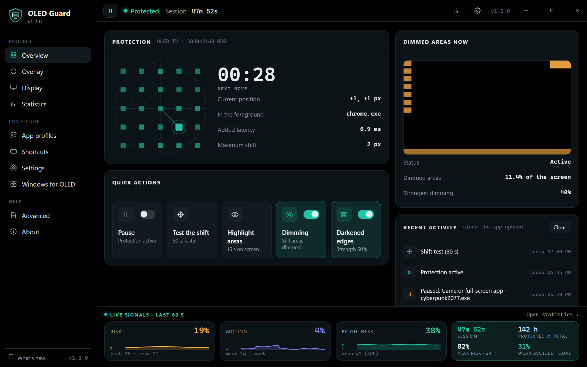

# OLED Guard

[](https://github.com/fedefreak92/oled-guard/actions/workflows/ci.yml)
[](LICENSE)

*[Leggi in italiano](README.it.md)*

A Windows app that protects an OLED TV used as a PC monitor from burn-in. It
captures the desktop on the GPU and redraws it, shifted by 1-3 pixels, in a
click-through overlay. It also dims small static elements (taskbar, icons, logos)
that stay bright for a long time, and shows live signals and usage statistics.

It was built for a 4K 143 Hz LG OLED TV with HDR always on, where the TV's own
pixel shift wasn't an option.

<!-- Screenshots: add the Overview and Statistics pages here, e.g.
 -->

## Features

- **Pixel shift**: the whole desktop moves by 1-3 px every 20-60 s, spread over
  2-5 s so text never blurs or jumps. Works in HDR and SDR with faithful colors.
- **Static-area dimming**: a compute shader finds 16x16 px cells that are bright
  and unchanged for minutes, and slowly lowers only the small ones (taskbar, icons,
  logos), leaving documents you are reading alone. The window under the mouse
  returns to normal at once.
- **Software brightness, darkened edges and away mode**: lowers the image when you
  step away from the PC.
- **Automatic pause** for games, fullscreen apps, presentations, lock screen, UAC
  and session switches, plus per-app rules.
- **Live signals and statistics**: risk, motion and brightness for the last 60 s,
  a 32x18 wear map of the panel, a 6 h / 24 h / 7 d risk chart, most used apps and
  a taskbar notification when unprotected risk stays high. Stats never leave the PC.
- **Windows tweaks for OLED** (only on request, with backup and restore): dark
  theme, taskbar auto-hide, display timeout, black screensaver and wallpaper,
  hidden desktop icons and more.
- Tray icon, global hotkeys, autostart, single instance, logs and an emergency exit.

## How it works

```
Desktop Duplication (DXGI)  ──►  D3D11 texture (stays on the GPU)
                                      │
                 ┌────────────────────┼─────────────────────┐
                 ▼                    ▼                     ▼
        CSDetect / CSActivate     CSSummary            shift_ps.hlsl
        which cells are static    32x18 zones,         draws the shifted frame,
        and bright, dim levels    read back 1x/s       dimming, brightness, edges
                                  (async, tiny)              │
                                                             ▼
                              DirectComposition overlay, click-through,
                              excluded from screen capture
```

- **No desktop pixels are read by the CPU.** Only a small summary buffer comes
  back, asynchronously with `D3D11_MAP_FLAG_DO_NOT_WAIT`, so the render thread
  never waits on the GPU.
- **The real cursor is never touched**: the click offset equals the current shift
  (about 2 px), a deliberate trade-off against a software cursor that would add
  latency and could disappear after a crash.
- **Fail-safe overlay**: an emergency thread with its own hotkey and a watchdog
  removes the overlay if the UI or render thread stops responding, so the screen is
  never left frozen or black.
- **Interface**: WebView2 with plain HTML/CSS/JS, a strict CSP (`default-src 'self'`),
  no libraries and no network access.

## Code layout

| Folder | Contents |
| --- | --- |
| `src/core` | Pure logic with no Windows headers: shift scheduler, pause rules, dimming model, statistics, alert, JSON, config, UI protocol |
| `src/app` | Win32, DXGI and D3D11: capture, render thread, overlay, tray, hotkeys, files, WebView2 window |
| `src/app/shaders` | HLSL shaders, compiled at build time with `fxc` and embedded as headers |
| `src/ui` | The interface (`mock.js` feeds fake data when the page runs in a normal browser) |
| `tests` | Unit tests for `src/core`, with a tiny framework and no dependencies |
| `tests_gpu` | Shader tests on the WARP software device |
| `docs/superpowers` | Design specs and implementation plans for each milestone |

## Testing

```powershell
powershell -ExecutionPolicy Bypass -File build.ps1
```

configures, builds and runs both test suites through CTest.

- **Unit tests** cover the pure logic in `src/core`.
- **GPU tests** run the real shaders on **WARP**, Direct3D's software rasterizer, so
  they need no graphics card and run in CI. Each shader is checked against a C++
  reference model (`src/core/dim_model.*`, `summary_model.*`, `shade_model.*`) on
  synthetic scenes: HDR values far above SDR white, odd resolutions, active windows
  and pauses.

## Building

Requirements:

- Windows 11 (Windows 10 2004 or later may work but is untested)
- Visual Studio 2022 or later, or the Build Tools, with the C++ desktop workload and
  a Windows 10/11 SDK (CMake and Ninja are included)
- A Direct3D 11 GPU to run the app; the tests also run without one

`build.ps1` finds Visual Studio by itself, builds into `build\` and runs the tests.
Use `-Config Debug` for a debug build and `-Clean` to start from scratch. The app is
`build\oled-guard.exe`; it needs the `ui` folder that the build copies next to it.

To work on the interface only, serve `src/ui` with any static server (for example
`python -m http.server --directory src/ui`) and open it in a browser: `mock.js`
supplies fake data.

## Usage

Run `oled-guard.exe`: it starts in the tray and protects the monitor chosen in the
settings. Default hotkeys (configurable):

| Hotkey | Action |
| --- | --- |
| `Ctrl+Alt+Shift+P` | Pause / resume |
| `Ctrl+Alt+Shift+O` | Turn the display off |
| `Ctrl+Alt+Shift+F12` | Emergency exit |

Command-line options: `--open-ui`, `--list-monitors`, `--debug`, `--fast-shift`
(a new position every 3-5 s, for testing) and `--dim-diagnostics` (dimming statistics
and snapshots in the log folder).

Files:

- Settings, statistics, history, the backup of Windows settings and the logs in
  `%APPDATA%\oled-guard` (`config.json`, `stats.json`, `history.json`,
  `windows-backup.json`, `logs\`)
- WebView2 data in `%LOCALAPPDATA%\oled-guard\webview2`
- Autostart in `HKCU\Software\Microsoft\Windows\CurrentVersion\Run` (value `OledGuard`),
  only if you enable it

No administrator rights are needed. Windows settings change only when you apply
them from the *Windows* page, and *Ripristina come prima* ("restore as before") puts back the saved values.

## Limitations

- One monitor at a time. Rotated (portrait) displays are not supported: the app
  stays paused.
- DRM-protected content is not detected: pause manually.
- The interface and the comments in the code are in Italian; identifiers are in
  English.
- The release build is not code-signed, so Windows SmartScreen will warn on first
  run.
- Tested on a single setup (RTX 5080, LG OLED TV, HDR on).

## Disclaimer

OLED Guard reduces how long the same pixels stay lit, but it cannot guarantee that
a panel will not burn in. Use it alongside your TV's own panel care features. It
does not talk to the TV or change its firmware.

## License

[MIT](LICENSE). Third-party components are listed in
[THIRD_PARTY_NOTICES.md](THIRD_PARTY_NOTICES.md).
